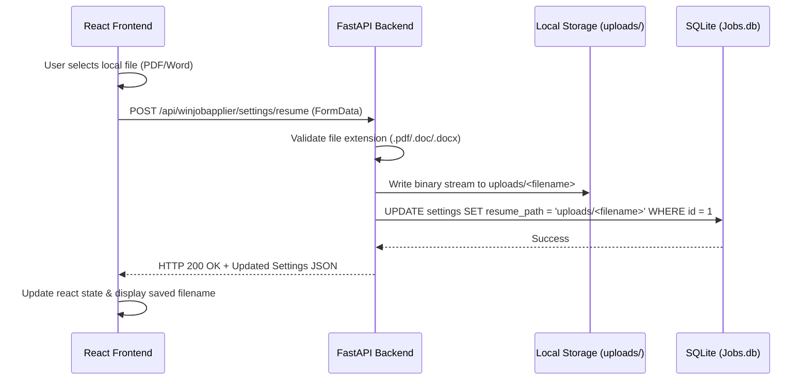

# WinJobApplier - Architecture & Implementation Documentation

Welcome! This document provides a complete guide to the **WinJobApplier** application, covering folder structure, database schema, backend API routes, frontend components, and the detailed logic of the recently implemented features.

---

## 1. Project Folder Structure

The project is structured into three main components: a Python FastAPI backend, a Vite React frontend, and a Rust-based job scraper.

```text
D:\WinJobApplier\
├── Jobs.db                      # SQLite database storing job matches and settings
├── db_init.py                   # Script to initialize/reset the SQLite schema
├── backend\                     # Python FastAPI server
│   ├── database.py              # SQLite CRUD queries (database manager)
│   └── main.py                  # API routes and process executors
├── frontend\                    # Vite React application
│   ├── index.html               # App entrypoint (SEO titles and metas)
│   ├── vite.config.js           # Vite configuration
│   ├── package.json             # Node dependencies and build scripts
│   └── src\
│       ├── main.jsx             # Hydrates and mounts the React App
│       ├── App.jsx              # Main UI controller (tabs, state, APIs)
│       ├── index.css            # Global CSS variables and typography system
│       └── App.css              # Component layout, grids, and dashboard styling
├── scraper\                     # Rust job scraper binary
│   ├── Cargo.toml               # Cargo package configuration
│   └── src\
│       └── main.rs              # Rust scraper source code
├── uploads\                     # Directory storing uploaded resumes (PDF/Word)
└── documentation\
    └── architecture_and_changes.md  # [NEW] This document
```

---

## 2. SQLite Database Schema (`Jobs.db`)

The SQLite database is initialized by [db_init.py](file:///d:/WinJobApplier/db_init.py). It consists of two tables:

### `settings` Table
Holds the user's application materials and scraping search keywords. **It is constrained to a single row (ID = 1)**.
* **`id`**: INTEGER PRIMARY KEY (locked to 1)
* **`name`**: TEXT (User's full name)
* **`email`**: TEXT (User's email)
* **`phone`**: TEXT (User's phone number)
* **`resume_path`**: TEXT (Relative path to saved resume file, e.g., `uploads/my_resume.pdf`)
* **`github`**: TEXT (GitHub URL)
* **`portfolio`**: TEXT (Portfolio URL)
* **`keywords`**: TEXT (Comma-separated keywords, e.g., `Rust, React, Remote`)
* **`updated_at`**: TIMESTAMP (Auto-updated on edit)

### `jobs` Table
Stores scraped job postings.
* **`id`**: INTEGER PRIMARY KEY AUTOINCREMENT
* **`guid`**: TEXT UNIQUE (Prevents duplicate entries during feed scraping)
* **`title`**: TEXT NOT NULL
* **`company`**: TEXT NOT NULL
* **`url`**: TEXT UNIQUE NOT NULL (Direct application page link)
* **`description`**: TEXT (Job description snippet)
* **`pub_date`**: TEXT (Posted date string)
* **`status`**: TEXT (Application pipeline phase: `Pending`, `Applied`, `Interviewing`, `Offered`, `Rejected`)
* **`created_at`**: TIMESTAMP (Datetime when job was scraped)
* **`applied_at`**: TIMESTAMP (Datetime when user updated status to `Applied`)

---

## 3. Backend Architecture & APIs (`backend/`)

The backend is built with FastAPI. It interacts with the database via `database.py` and coordinates scraper binary execution.

### Active Endpoints (`backend/main.py`)
1. **Get Settings** (`GET /api/winjobapplier/settings`):
   Retrieves the row from the `settings` table.
2. **Update Settings** (`POST /api/winjobapplier/settings`):
   Updates settings fields in database and returns the updated record.
3. **Upload Resume File** (`POST /api/winjobapplier/settings/resume`):
   - Accepts a binary file upload (`UploadFile`).
   - Restricts file types to `.pdf`, `.docx`, or `.doc`.
   - Saves the file inside the project's `uploads/` directory on disk.
   - Saves the path `uploads/filename.ext` in the database.
4. **Static Files Directory** (`/uploads`):
   Mounted at `app.mount("/uploads", StaticFiles(directory=uploads_dir), name="uploads")` to allow the frontend to statically resolve, view, or download the uploaded resumes.
5. **Get Jobs List** (`GET /api/winjobapplier/jobs`):
   Fetches all jobs in the database ordered by newest first.
6. **Update Pipeline Status** (`POST /api/winjobapplier/jobs/{job_id}/status`):
   Transitions a job's pipeline state (e.g. `Applied`, `Interviewing`). If status becomes `Applied`, saves `applied_at` datetime.
7. **Trigger Scraper Binary** (`POST /api/winjobapplier/scraper/trigger`):
   Executes the compiled Rust binary located at `scraper/target/debug/scraper.exe` using Python `subprocess.run()`. It streams stdout back to the API request to show console logs in the frontend.

---

## 4. Frontend Architecture & Styles (`frontend/`)

The frontend is a single-page reactive dashboard built with Vite, React, and Vanilla CSS.

### Components & State (`App.jsx`)
The UI is controlled by a set of interactive states in [App.jsx](file:///d:/WinJobApplier/frontend/src/App.jsx):
* **`activeTab`**: Tracks selected view (`jobs` | `scraper` | `settings`).
* **`jobs`**: An array of job postings fetched from the backend.
* **`settings`**: Object populated with database user settings.
* **`logs`**: Array of console strings displaying live scraping logs.
* **`toast`**: Notification banners appearing upon success or error.

### Styling System
* **[index.css](file:///d:/WinJobApplier/frontend/src/index.css)**: Implements our **Design Tokens**. Imports Google Fonts `Outfit` and `Inter`, and defines CSS custom properties for global colors, glassmorphism templates, background gradients, custom scrollbars, and buttons.
* **[App.css](file:///d:/WinJobApplier/frontend/src/App.css)**: Lays out the sidebar layout, dashboard counters (metrics), responsive job cards grid, scraper terminal simulator, settings input controls, and custom file upload buttons.

### Bug Resolution: Lucide-React Brand Icons
Vite initially failed to compile due to a `[MISSING_EXPORT]` error: `"Github" is not exported by "node_modules/lucide-react"`.
* **Reason**: Lucide deprecated and removed all brand icons (such as GitHub, GitLab, and LinkedIn) in their v1.0 release.
* **Fix**: We removed `Github` from the `lucide-react` imports and implemented a lightweight, inline SVG `<GithubIcon />` component inside `App.jsx` to preserve the premium visual design.

---

## 5. File Uploader Workflows

Here is the step-by-step lifecycle of a file upload:



---

## 6. How to Run & Verify

To run the application locally, open two terminals:

### Terminal 1: Python FastAPI Backend
Go to the root directory `D:\WinJobApplier` and start uvicorn:
```powershell
.\.venv\Scripts\python -m uvicorn backend.main:app --reload
```
This serves the API on `http://127.0.0.1:8000`.

### Terminal 2: Vite React Frontend
Go to the frontend directory `D:\WinJobApplier\frontend` and start the Vite dev server:
```powershell
npm run dev
```
Vite will compile and serve the dashboard (usually on `http://localhost:5173/` or `http://localhost:5174/` if 5173 is occupied). Open this URL in your web browser.
